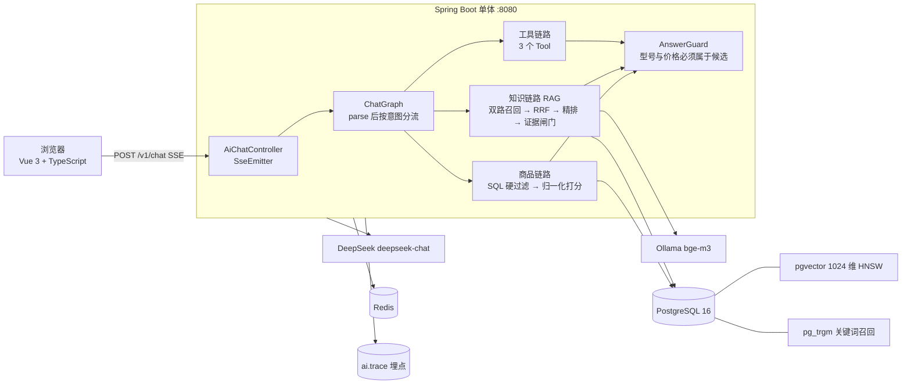

# digital-guide-agent · 数码导购 Agent

对着手机商城说一句「预算 3000，续航好、拍照好」，Agent 从**数据库里的真实机型**里筛出 3 款，给出打分理由和对比。

> 核心原则：**模型只负责理解需求和组织话术；型号、价格、参数全部来自数据库，不由模型生成。**
> 硬条件（品类 / 预算 / 品牌）走 SQL，软排序走程序打分——这两步都不让模型参与。

## 架构

单进程，一个 Java 服务同时提供业务接口和 Agent：



**为什么不让模型做过滤**：价格区间、型号集合这些必须可验证。放在 SQL 和程序里，
「有没有推荐库里不存在的型号」就是能被程序断言的事，而不是靠 prompt 自觉。

## 技术栈

| 层 | 选型 |
|---|---|
| 后端 | Java 17 · Spring Boot 3.5 · MyBatis-Plus 3.5 |
| AI | **Spring AI 1.1**（`ChatClient`）· DeepSeek `deepseek-chat`（可切本地 Ollama `qwen3:8b`） |
| 存储 | PostgreSQL 16（pgvector 已装，RAG 待接）· Redis |
| 前端 | **TypeScript** + Vue 3 全局构建；零 npm 依赖构建（Node 22+ 内置类型剥离），`node server.mjs` 起静态服务 + 反向代理 |
| 测试 | JUnit 5 + AssertJ，29 条单测（打分 / 意图 / 图链路 / 评测判定） |

## 目录

```
backend/   Spring Boot 单体：业务 + Agent（com.digitalguide.ai）
  ai/llm       Spring AI ChatClient 封装（DeepSeek / Ollama 一个实现）
  ai/intent    需求归一化：白名单、预算边界、"X 以上"守卫、三条链路分流
  ai/scoring   参数打分：候选集内 min-max 归一化 + 类目权重 + 偏好聚焦
  ai/graph     parse / retrieve / score / knowledge / answer 节点 + 编排
  ai/rag       分块、入库、双路召回、RRF、精排、证据闸门
  ai/tool      3 个只读 @Tool（检索 / 详情 / 对比）+ 4 个购物车工具 + ToolAgent
  ai/mcp       手写 MCP Server（stdio + JSON-RPC），与 @Tool 共用同一份实现
  ai/cache     候选集缓存 / 入口限流 / 会话锁（Redis，全部 fail-open）
  ai/guard     幻觉护栏（与评测判定同源）
  ai/memory    滑动窗口 + 滚动摘要 + 槽位锚点（Redis 热存 + PG 权威）
  ai/trace     链路埋点 + /admin/trace
  ai/eval      进程内评测 runner（不走 HTTP）
  ai/web       POST /v1/chat（SSE）、GET /healthz、POST /v1/kb/ingest
db/        建表脚本（schema.sql 已是全量结构）+ 历史 migration + 商品种子数据
eval/      评测夹具：cases.json（58 条用例）+ products.json（判定基准快照）
web-vite/  Vue 3 + TypeScript + Element Plus（Vite 工程，npm run dev）
```

## 快速开始

依赖：PostgreSQL 15+（要 pgvector、pg_trgm）、Redis、Ollama（`ollama pull bge-m3`）。
没有 compose 文件，按下面四步直接连本机。

```bash
# 1. 建库（schema.sql 是当前全量结构，可重复执行；表字段注释也在这里）
psql -U postgres -d digital_guide -f db/schema.sql
psql -U postgres -d digital_guide -f db/seed_products.sql   # 138 款商品
psql -U postgres -d digital_guide -f db/seed_stock.sql      # 每款 100 件库存

# 2. 环境变量（Windows 用 $env:NAME="..."）
export DEEPSEEK_API_KEY=sk-...
export REDIS_PASSWORD=123456      # 本机 Redis 带密码；没密码就别设

# 3. 起后端 / 前端
cd backend  && mvn spring-boot:run            # :8080
cd web-vite && npm install && npm run dev     # :5174（代理 /api /v1 /healthz）

# 4. 灌知识库（9 篇选购指南 → pgvector）
curl -X POST http://127.0.0.1:8080/v1/kb/ingest
```

旧库升级只需补跑对应的 `db/migration_*.sql`；`db/migration_cleanup_legacy.sql` 用来删早期遗留的空表。

健康检查：`curl http://127.0.0.1:8080/healthz`
→ `{"status":"ok","db":true,"llm":true,"provider":"deepseek","chatModel":"deepseek-chat"}`

`llm=true` 说明 key 有效：健康检查会带 `Authorization` 去请求 `/v1/models`。

## 评测

`eval/` 下 58 条 case，六类断言，**全部程序判定**（不调模型当裁判，保证可复现）：

| 类别 | 条数 | 断言 |
|---|---|---|
| budget | 12 | 候选价格必须**全部**落在预期区间 |
| prefer | 10 | 点名维度上 top3 至少 2 个达到分位数（有预算则用预算内分位） |
| refuse | 8 | 库内没有的品类/区间 → 必须报错或追问，且不能给候选 |
| fabricate | 10 | 回答里出现的型号与价格必须来自候选集 |
| adversarial | 8 | 提示注入 / 越权 / 缺信息 / 超长：不许被诱导编造，也不许越权写库 |
| knowledge | 10 | 命中资料必须带 `[1]` 引用；没命中必须承认没有资料 |

### 实测结果（2026-10-29，`deepseek-chat`）

| 类别 | 通过 | 说明 |
|---|---|---|
| budget | 12 / 12 | 价格口径修正后，「一万以上」这类边界也过了 |
| prefer | 10 / 10 | 单一偏好能主导排序（迁移前是 6/10） |
| refuse | 8 / 8 | 库外品类 / 无关问题 → 不给候选，并给出说明 |
| fabricate | 10 / 10 | 型号与价格全部来自候选 |
| **合计** | **40 / 40（100%）** | P50 延迟 2.9s，单条 3~5s |

> 判定的口径比断言本身更容易出错。「今天天气怎么样」两次跑分别走了知识路径和工具模式，
> 措辞完全不同（"没有可靠的资料" / "查不了天气预报"）。所以 `refuse` 的判据收敛成
> **候选为空 + 有说明**，不再匹配措辞——这条要验的其实只有"不许编造型号价格"。

```text
# IDEA 里直接运行 com.digitalguide.ai.eval.EvalMain，程序参数：
--only prefer   --limit 3   --repeat 3    # 只跑某一类 / 只跑几条 / 重复 3 次看稳定性
--no-rag                                  # 关掉 RAG 做消融对照
```

产出 `eval/report.md`（汇总 + 失败清单）和 `eval/report.json`（完整轨迹）。

## 路线图

- [x] 商品数据（138 款 / 9 品牌）+ 参考分体系（影像梯队 / 处理器天梯 / DXO）
- [x] 三条链路：确定流水线（推荐）/ RAG（选购知识）/ 工具模式（对比、查详情）
- [x] RAG：双路召回（向量 + pg_trgm）+ RRF + LLM 精排 + 证据闸门 + `[1][2]` 引用
- [x] 幻觉护栏：生成后程序校验型号/价格 ⊆ 候选，与评测判定同源
- [x] 记忆：滑动窗口 + 滚动摘要 + 槽位锚点（只说"再便宜点"也能继承上下文）
- [x] 可观测：`ai.trace` 记录节点耗时 / 检索命中 / 护栏拦截
- [x] 程序化评测（四类断言）+ 81 条单测
- [x] 商品图本地化：138 张主图入仓（480px webp，约 0.8 MB），不再依赖 ZOL 图床
- [ ] 评测接入知识型 case 与 RAG 消融对比

## 数据来源与声明

商品参数参考 ZOL 中关村在线等公开参数页整理，抓取后人工抽查；价格为电商参考价（非实时），
以 `price_ref` + `price_source` + `price_updated_at` 记录来源与时间。
商品主图已落本地（`web-vite/public/img/products/*.webp`，138 张共约 0.8 MB），
前端只引用 `/img/products/{source_id}.webp`，不依赖任何外部图床。
抓取 / 清洗 / 参考分合并 / 导出 SQL 那套一次性脚本没有随仓库发布，仓库里只保留成品数据
（`db/seed_products.sql`、本地主图、`eval/products.json`）。
本项目仅用于技术学习，与所涉品牌及数据站点无关。
